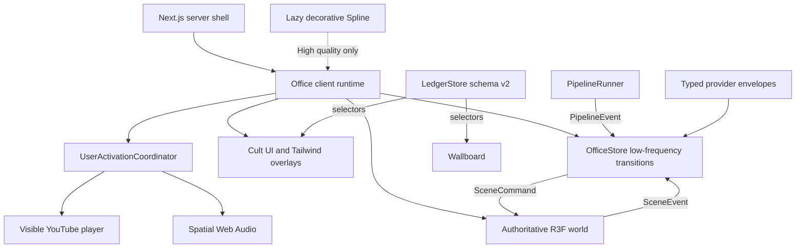
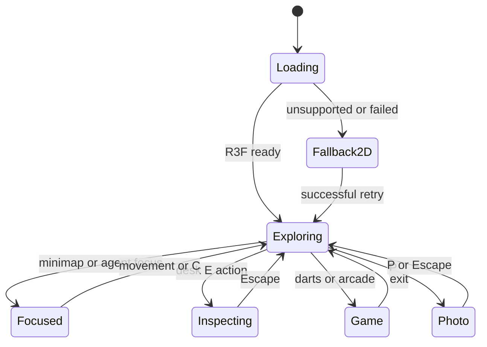
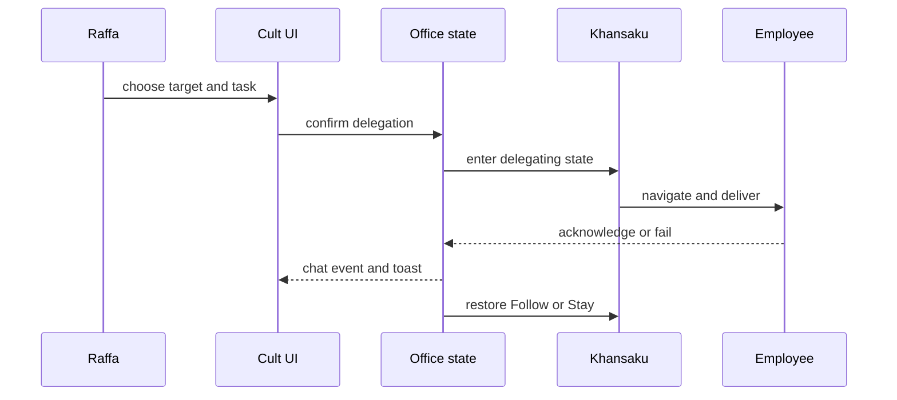
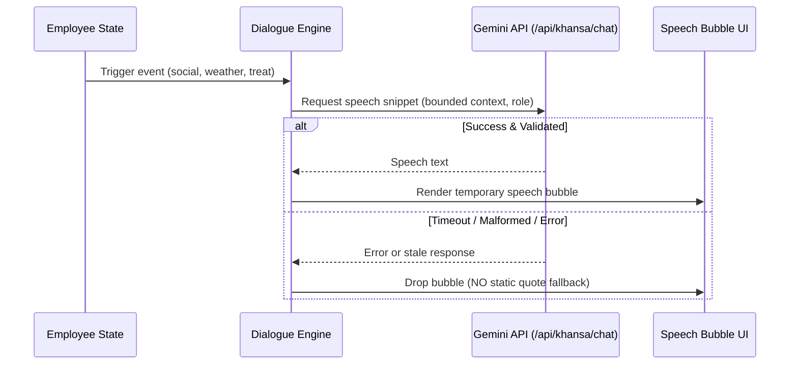
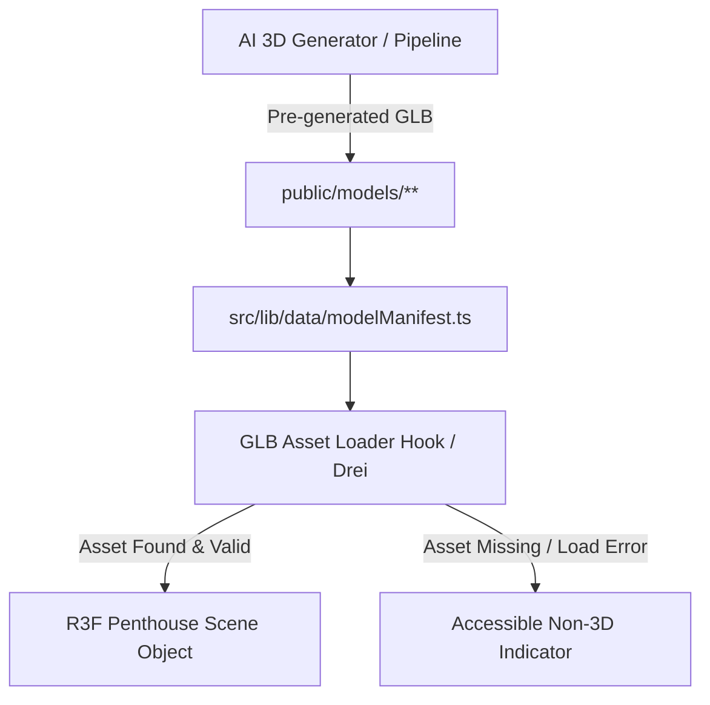

# Penthouse Office Platform - Plan

## Goal Capsule

- **Objective:** Users can explore a polished virtual penthouse office, inspect and reset paper-trading accounts, interact with employees and entertainment features, and recover from media, storage, or WebGL failures without losing unrelated state.
- **Means:** Replace the imperative office renderer with one React Three Fiber world, move UI to Tailwind/Cult UI patterns, and coordinate cross-feature behavior through typed domain state and events (KTD1, KTD2, KTD3).
- **Authority:** Product behavior follows `PRD_PAPER_BOTS_IMPROVEMENT.md`; this plan resolves technical contradictions using repository evidence and official framework constraints.
- **Execution profile:** Cross-cutting Next.js 16 / React 19 migration with persistent client data, external media, WebGL, Web Audio, and browser acceptance testing.
- **Stop conditions:** Stop before shipping if the paper-only boundary is violated, the R3F cutover leaves two authoritative renderers, persisted ledger migration loses user positions without an explicit recovery path, or build/browser verification fails.
- **Finish and ship:** The implementation owner completes local verification, review, pull-request delivery, CI remediation, and the user-authorized merge into `main`.

---

## Product Contract

### Summary

Implement the complete v3.5 penthouse-office experience from `PRD_PAPER_BOTS_IMPROVEMENT.md`: humanized quant employees, male Vani, a rooftop terrace, WIB-aware sky and weather, declarative 3D, Cult UI/Tailwind/Geist/Lucide UI, resettable paper trading, synthetic backtests, social/delegation behavior, music, minigames, spatial ambience, executive controls, and resilient fallbacks.

### Problem Frame

The current single-page app concentrates scene, keyboard, modal, music, trading, and pipeline state in `src/app/page.tsx`. Its 3D world lives in a 1,449-line imperative `OfficeScene`, visible paper trading uses a compatibility model instead of the typed ledger, and styling is split across Emotion, inline styles, and a 1,562-line global stylesheet. Most PRD features do not exist, and layering them onto the current ownership model would multiply state and lifecycle conflicts.

Several PRD statements are technically or ethically impossible as absolute guarantees. Browsers may block autoplay, WebGL contexts can be lost, third-party playlist items can disappear, and “never close a losing trade” does not prove profitable trading. The implementation must preserve the requested demonstration experience while labeling simulations honestly and exposing unrealized risk.

### Actors

- A1. **Bos Raffa:** Navigates the office, inspects employees, controls ambience, delegates work, resets paper accounts, plays games, and captures photos.
- A2. **Khansaku:** Companion, command intake, delegation runner, and office-treat coordinator.
- A3. **Employees:** Engineering staff plus Altair, Kenzo, Damian, and Vani Aryasetya; they work, move, socialize, react to weather, and emit office events.
- A4. **Browser/runtime:** Enforces autoplay, WebGL, storage, CORS, and performance constraints.
- A5. **External providers:** YouTube, Gemini, market feeds, optional weather, Spline, and optional economic-calendar sources; each may be unavailable and receives only bounded data required for its feature.

### Key Decisions

- **Cult UI/Tailwind replaces authored component CSS and Emotion.** (session-settled: user-directed — chosen over continuing plain CSS/Emotion: the user requires Cult UI-based components and no ordinary component CSS.) Governs R18, R19.
- **The seven immersion ideas are in scope.** (session-settled: user-approved — chosen over leaving the v3.4 feature set unchanged: the user approved weather, spatial audio, office treats, wallboard, wardrobe/emotes, toasts, and photo mode.) Governs R11-R17.
- **Paper trading remains simulation-only.** Governs R6-R8, R22.
- **Brand application is Yapping Techflow.** (session-settled: user-directed — UI, metadata, favicon, documentation, and photo watermark use Yapping Techflow with AI-generated logo; employee/account IDs and storage keys remain preserved for compatibility.) Governs R26.
- **Full R3F scene without Spline.** (session-settled: user-directed — all visible 3D geometry uses pre-generated AI local GLBs from a typed manifest with accessible non-3D fallback on error; no Spline runtime and no visible procedural placeholders.) Governs R25.
- **AI dialogue for employee speech on demand.** (session-settled: user-directed — dynamic Gemini generation for employee speech bubbles on social/weather/treat events; invalid/timeout output dropped with no static quote fallback; AI never mutates movement or world state.) Governs R24.
- **Damian panel embeds official TradingView XAUUSD chart.** (session-settled: user-directed — embed TradingView Advanced Chart OANDA:XAUUSD with keyboard-accessible fallback link; Exness feed remains the independent source for paper EA.) Governs R27.
- **Automated prediction paper bot runtime.** (session-settled: user-directed — application-scoped runtime executes BTC scalper, arbitrage, momentum, and Kelly strategies using real CoinGecko and Polymarket Gamma/CLOB quotes/settlements; modal only inspects/pauses.) Governs R28.

### Requirements

**Identity and office world**

- R1. Replace the three impersonal trading bots with Altair Raditya (`EMP-007`), Kenzo Danendra (`EMP-008`), and Damian Prasetya (`EMP-009`) across roster, scene, trading, chat, and persisted account mappings.
- R2. Replace Vani Maharani with male QA engineer Vani Aryasetya (`EMP-005`, age 23) across all user-visible and prompt data.
- R3. Render one navigable penthouse office containing Executive, Engineering, War Room, Skyline Suite, Pantry, and Rooftop Terrace zones with shared collision, focus, and minimap coordinates.
- R4. Synchronize clock and sky to `Asia/Jakarta` with exact phase boundaries at 05:30, 09:30, 15:30, and 18:15 WIB; manual visual override must not change the real clock.
- R5. Provide WebGL unsupported, render-error, and context-loss states that preserve non-3D controls and unrelated state; the fallback is a persistent DOM office shell with ordered zones/employees, direct feature actions, status announcements, focus management, and explicit WebGL retry.

**Trading and analytics**

- R6. Use one versioned multi-currency paper ledger with seed balances `150 SOL`, `5,000 USDC`, and `10,000 USD`; account identity stays separate from employee identity and persisted amounts use currency-specific integer minor units.
- R7. Reset all paper accounts atomically after confirmation, clearing positions, reservations, history, equity/backtest series, and risk state while preserving music, wardrobe, weather, chat, and game preferences/scores.
- R8. Provide Damian’s XAUUSD backtest controls for M5/M15/H1 and 1M/6M/1Y with computed drawdown, realized/unrealized P&L, sample size, assumptions, and data provenance from a versioned deterministic synthetic XAUUSD base series. Fixtures compute synchronously through the pure paper-engine helpers; background execution is added only if measured computation exceeds the interaction budget.
- R9. A 100.00% result may appear only for a named deterministic synthetic fixture and must read “Closed-trade win rate — synthetic paper-backtest fixture (not a guarantee)”; open losing baskets and drawdown remain visible.
- R10. The wallboard derives converted aggregate paper equity from the authoritative ledger and typed quote envelopes; missing or stale conversion data produces a partial/unavailable label rather than summing raw SOL, USDC, and USD units.

**Immersion, social systems, and media**

- R11. Weather supports live, stale, unavailable, and manual clear/fog/rain states; rain drives terrace visuals, audio, and employee shelter behavior.
- R12. Spatial ambience uses a user-unlocked Web Audio graph for office, weather, and notification sounds; YouTube remains a separate policy-compliant iframe player.
- R13. Khansaku supports Follow and Stay modes plus confirmed delegation states that return to the selected companion mode after delivery or failure.
- R14. Employees transition among work, pantry, terrace, chat, shelter, and return states; gossip stops near Raffa and resumes after a cooldown.
- R15. Office treats publish group-chat events, deliver a single boost, and restore employee stamina/focus to 100% without double application.
- R16. The primary music playlist is YouTube playlist `PLZVXIrT2s1CE`; the existing DJ list remains secondary, and blocked/unavailable playback must remain recoverable through visible controls.
- R17. Darts, Crypto Candle Runner, and Whack-A-Bug provide deterministic scoring, pause/exit handling, session fallback, and resettable local leaderboards.

**UI, personalization, and platform rules**

- R18. App-controlled UI uses copied/adapted Cult UI-compatible primitives, Tailwind v4 utilities, Geist Sans/Mono, and static named Lucide imports; one global Tailwind/theme stylesheet is permitted.
- R19. Remove Emotion, authored component selector sheets, hand-authored UI icon SVGs, and obsolete generation guidance after every consumer migrates.
- R20. Wardrobe presets and emotes are visual-only, input-safe, and persisted only after apply; photo mode owns `P`, hides HUD, restores camera/UI state, and reports capture/CORS limitations.
- R21. In-app toasts deduplicate bursts, remain accessible without audio, label paper/simulated profit, and never request OS notification permission.
- R22. No feature may connect private keys, place live orders, or present simulated performance as guaranteed future profit.
- R23. Existing Jira, repository inspection, terminal, mission pipeline, employee directory, and subordinate interactions remain operational.

**AI dialogue, generated assets, brand, and automated trading**

- R24. **AI dialogue:** Send event and minimum office context to Gemini API for employee speech bubbles on-demand; strictly validate output and drop failed/timed-out/stale responses without falling back to static quotes; runtime retains deterministic movement and state control.
- R25. **Generated 3D assets:** All visible 3D objects (architecture, characters, furniture, props) use local AI-generated GLBs specified in a typed manifest; missing or failed assets degrade to an accessible non-3D indicator rather than visible procedural mesh placeholders.
- R26. **Brand and identity:** The platform brand is Yapping Techflow, featuring an AI-generated logo across UI, metadata, favicon, documentation, and photo watermarks, preserving legacy employee and account IDs and storage keys.
- R27. **TradingView XAUUSD chart:** Damian's panel embeds the official TradingView Advanced Chart configured for `OANDA:XAUUSD`, with a direct keyboard-accessible link fallback (`https://id.tradingview.com/chart/m0726Zvv/?symbol=OANDA%3AXAUUSD`); Exness remains the independent data source for paper EA trading.
- R28. **Automated paper bot:** A single application-level runtime executes automated paper prediction strategies (BTC scalper, arbitrage, momentum, Kelly sizing) against real CoinGecko spot and Polymarket Gamma/CLOB executable quotes and official settlements; ledger v2 records all paper orders and positions; modal toggle controls monitoring and pausing without owning bot lifecycle.

### Key Flows

- F1. **Office entry:** User gesture unlocks local audio, the app selects the default playlist, and the runtime enters either R3F office mode or an accessible 2D fallback.
- F2. **Exploration and inspection:** Movement and minimap focus update the shared scene state; desk proximity exposes `E`; camera transition opens the appropriate employee/laptop view.
- F3. **Paper reset:** User opens trading, reviews a destructive-action confirmation, confirms once, and receives an atomic reset or a session-only persistence warning.
- F4. **Delegation:** Raffa selects a target and task, confirms, Khansaku walks to the target, emits delivery status, and returns to Follow or Stay.
- F5. **Weather reaction:** Weather changes to rain, terrace effects fade in, outdoor agents seek shelter, and local ambience follows audio permission and door occlusion.
- F6. **Photo mode:** `P` captures the prior camera/HUD state, enables drone controls, renders an origin-clean capture when possible, then restores state exactly.

### Acceptance Examples

- AE1. **Covers R4.** Given the browser timezone is UTC, when the instant corresponds to 15:30 WIB, then the HUD shows WIB and the visual phase becomes sunset.
- AE2. **Covers R5.** Given WebGL2 is unavailable, when office entry completes, then the user can still access trading, music, chat, wardrobe, and minimap fallback controls.
- AE3. **Covers R6, R7.** Given all accounts have trades and open positions, when reset is confirmed, then the three required seed balances return atomically and unrelated preferences remain unchanged.
- AE4. **Covers R8, R9.** Given a synthetic fixture with no closed losses and one underwater open basket, when the backtest completes, then closed-trade win rate can show 100.00% while unrealized loss, drawdown, and the non-guarantee label remain visible.
- AE5. **Covers R13.** Given Khansaku is in Stay mode, when a delegation completes, then she returns to the recorded Stay location instead of following Raffa.
- AE6. **Covers R16.** Given autoplay is blocked, when office entry selects the primary playlist, then playback remains paused with a visible Play control and no false error.
- AE7. **Covers R20.** Given photo mode is active, when `P` is pressed again, then music state is unchanged and the previous camera/HUD state is restored.

### Success Criteria

- The production build succeeds under Next.js 16.3.8 / React 19.3 with one authoritative R3F canvas and no Emotion runtime.
- The defined browser smoke flows complete without observed uncaught errors, `NaN`, duplicate listeners/canvases, or state loss.
- Worst-case office quality can degrade DPR, shadows, rain, reflections, Sparkles, and postprocessing while preserving interaction.
- Every unavailable external provider produces a labeled fallback instead of fabricated live data.

### Scope Boundaries

**In scope**

- All user-visible PRD v3.5 capabilities, their typed state, persistence, accessibility, and browser failure paths.
- Clean migration of current call sites and deletion of superseded renderer, ledger compatibility layer, Emotion code, and obsolete route paths.

**Outside this product’s identity**

- Live-fund trading, wallet/private-key handling, or exchange order execution.
- Claims that guarantee profit, zero bugs, universal autoplay, permanent third-party availability, or fixed FPS on every device.
- A server-backed multiplayer leaderboard or employee-chat service; this version remains local/session-persistent.

**Deferred to Follow-Up Work**

- Provider-backed Jakarta weather and economic-calendar routes are added only when credentials, licensing, and provider contracts already exist; manual/unavailable states remain fully functional without dormant endpoints.
- Bespoke licensed GLB/Spline/audio artwork may use repository-owned procedural or placeholder assets when no licensed source file exists; no unlicensed downloads enter the repository.

### Product Contract Preservation

The PRD scope is preserved. Absolute guarantee wording is narrowed only where browsers, external providers, or financial truth make the literal claim impossible; the requested visual/demo outcomes remain observable and explicitly labeled.

---

## Planning Contract

### Key Technical Decisions

- KTD1. **One authoritative R3F world owns navigation, rendering, camera, input, and disposal.** Use R3F 9.x and Drei 10.x compatible with React 19/Three 0.186; remove `src/lib/engine/officeScene.ts` after parity. Optional Spline is a separate lazy decorative surface with no input, lighting, weather, navigation, or capture authority and is disabled outside High quality. Governs R3-R5, R20.
- KTD2. **Domain ownership is split across explicit ports, not one god store.** `OfficeStore` owns low-frequency office transitions; `LedgerStore` exclusively owns paper state; `MediaController` owns YouTube/local-audio lifecycle; `PipelineRunner` keeps execution state; R3F owns frame-local objects and positions. Typed scene, pipeline, ledger-selector, and media ports connect them. Governs R3-R5, R11-R17, R20-R21.
- KTD3. **A single application-scoped ledger schema v2 becomes the only trading model.** `PaperLedgerProvider` exposes one snapshot/subscription/command surface to every trading panel and wallboard. Persist account amounts as lamports, micro-USDC, and cents; migrate or explicitly recover both current v1 shapes; retain the one-way migrator while deleting runtime `PaperState` aliases and `/api/trading/*` after caller cutover. Every write validates durable revision/reset epoch inside its IndexedDB transaction, broadcasts successful commits, and forces stale tabs to rehydrate before another command. Governs R6-R10, R22.
- KTD4. **The App Router shell is server-rendered with one client runtime owner.** `src/app/page.tsx` becomes a thin shell; `OfficeClientBoundary`/`OfficeRuntime` owns dynamic R3F loading, global shortcuts, user activation, service lifecycle, overlays, and fallback state. Governs R3-R5, R16, R20, R23.
- KTD5. **Cult UI is copied source, not a runtime suite.** Add only the primitives needed, preserve its MIT notice, expose existing `Button`/`Modal`/`Badge` APIs where useful, and use Tailwind theme tokens for consistent styling. Governs R18-R19.
- KTD6. **External data uses typed envelopes with honest availability.** Extend the existing market-envelope pattern to weather/calendar; no route fabricates live values. Governs R10-R12, R16.
- KTD7. **One synchronous activation coordinator unlocks local audio and requests YouTube playback.** The entry gesture records independent outcomes for Web Audio and YouTube; neither subsystem owns the gesture or promises success. Governs R12, R16, R21.
- KTD8. **Photo export covers the origin-clean R3F pipeline.** Use a temporary bounded render target, same-origin/CORS-safe assets, explicit dimensions, and a visible limitation when Spline/YouTube/DOM cannot be composited. Dispose capture resources on success, cancellation, and failure. Governs R20.
- KTD9. **A measurable quality policy bounds GPU and lifecycle cost.** Start at Medium, treat user choice as a ceiling, downgrade when rolling p95 frame time exceeds 25 ms for five seconds, and keep reduced-motion behavior independent of GPU tier. High/Medium/Low cap DPR at 1.5/1.25/1.0, rain at 1,500/750/250 drops, Sparkles at 100/50/25, and photo output at 8.3/3.7/2.1 megapixels. Governs R3-R5, R11, R17, R20.

### High-Level Technical Design









```mermaid
flowchart LR
  CG[CoinGecko API] -->|BTC Spot Ticker| Poller[Market Poller Singleton]
  PolyGamma[Polymarket Gamma] -->|Market / Resolution| Poller
  PolyCLOB[Polymarket CLOB] -->|Executable Bid/Ask Book| Poller
  Poller -->|Validated Fresh Quotes| BotRuntime[Application Prediction Bot Runtime]
  BotRuntime -->|Signals & Risk Sizing| Ledger[LedgerStore v2 (Paper Positions & Orders)]
  PolyGamma -.->|Official Settlement Event| BotRuntime
  BotRuntime -.->|Settlement PnL| Ledger
```



### Requirements & Units Cross-Reference

|Requirement|Unit dan file utama|Acceptance minimum|Risiko utama|
|---|---|---|---|
|R24 — AI dialogue|U6; `src/lib/engine/employeeDialogue.ts`, `src/app/api/khansa/chat/route.ts`, `src/components/chat/**`, `scripts/verify-employee-dialogue.mjs`|Respons valid/current muncul; error, timeout, malformed output, atau event usang tidak menghasilkan quote statis; output AI tidak dapat mengubah gerakan/perintah.|Provider gagal/lambat; respons teks tak tepercaya atau bocor ke log.|
|R25 — generated 3D assets|U15/U4; `public/models/**`, `src/lib/data/modelManifest.ts`, `src/components/canvas/**`, `scripts/verify-generated-assets.mjs`|Manifest mencakup semua karakter dan visible geometry; model GLB dapat dimuat; missing asset memakai fallback aksesibel non-3D, bukan mesh visible buatan.|Asset/generator/rigging tidak tersedia; ukuran asset merusak waktu muat atau performa.|
|R26 — brand/logo|U10/U16/U11; `public/brand/**`, `src/app/layout.tsx`, splash/nav/cards, favicon, photo watermark, README brand-only|Branding browser/metadata/logo/watermark konsisten; tidak ada perubahan employee/account IDs atau storage keys; perubahan README tidak menimpa WIP lain.|Perubahan merusak referensi lama atau menimpa README milik pengguna.|
|R27 — chart|U7; `src/components/laptop/TradingViewXauChart.tsx`, laptop panel, `scripts/verify-tradingview-chart.mjs`, E2E|Widget dikonfigurasi `OANDA:XAUUSD`; bila diblokir link persis di atas dapat dibuka dengan keyboard; status/feed Exness tetap independen dan jujur.|Widget pihak ketiga diblokir; layout privat chart tidak dapat disalin ke widget publik.|
|R28 — automated paper bot|U12/U4; `src/app/api/markets/bitcoin/route.ts`, `src/app/api/markets/polymarket/route.ts`, `src/app/api/markets/polymarket/[id]/route.ts`, `src/lib/engine/predictionBot.ts`, `src/components/trading/PredictionBotRuntime.tsx`, modal, `scripts/verify-prediction-bot.mjs`|Simulasikan feed valid/stale, tick duplikat, reset, modal reopen, dan outcome unresolved/resolved; hanya satu poller; hanya quote/resolution sah memengaruhi ledger paper.|Rate limit feed/order book; token quote atau hasil pasar ambigu.|

### Output Structure

```text
src/
  components/
    canvas/
    chat/
    executive/
    laptop/
    map/
    minigames/
    office/
    social/
  lib/
    engine/
    storage/
    types/
tests/
  e2e/
```

### Assumptions

- The user authorizes end-to-end implementation and merge, but existing unrelated `README.md` modifications remain user-owned and are not overwritten or committed.
- Default playlist means selected on entry; audible playback remains subject to user gesture and YouTube/browser policy.
- Provider-backed weather/calendar data is optional; labeled manual/unavailable states satisfy the experience without invented data.
- Cult UI component names in the PRD describe visual patterns. The implementation may adapt the closest accessible registry primitive rather than inventing a nonexistent package API.
- The existing procedural office geometry is acceptable when no licensed external GLB/Spline/audio asset is present.

### System-Wide Impact

- **Persistence:** One hydrated application owner uses logical `meta`, `paper`, `officePreferences`, `officeEvents`, `gameScores`, and `migrationArchive` namespaces. A paper reset never clears the database or unrelated namespaces. Serialized writes carry a revision/reset epoch, compare it durably, and notify other tabs so stale work cannot resurrect.
- **Input:** One coordinator arbitrates movement, modals, games, emotes, inspection, and photo mode; `P` moves from music to photo mode.
- **Performance:** R3F is the sole office clock. Frame callbacks never persist, fetch, allocate scene resources, or dispatch movement/camera/particle state. Proximity/shelter checks run at most 10 Hz, social scheduling at most 2 Hz, and hidden tabs suspend nonessential animation/audio before resuming with clamped elapsed time.
- **Bounded data:** Office events retain 256 entries, group chat 200, toast IDs 64 with at most five visible, leaderboards top 10 per game, backtest charts 2,000 display points, weather one current plus one last-known-good envelope, and local ambience at most four decoded buffers. Ledger balances, reservations, and unsettled records are never evicted.
- **Responsive/accessibility:** At widths below Tailwind `md`, entry/exit, minimap/menu, and media recovery stay in a compact fixed bar; secondary controls move into one focus-managed drawer; feature dialogs become full-screen; only one non-obscuring toast stack appears; touch targets are at least 44 px. At `md` and above, docked overlays are allowed. Every canvas action has a DOM alternative, and reduced motion disables nonessential shake/transitions.
- **Security/privacy:** Credential-backed routes require local/same-origin authorization and bounded quotas. Local repository actions are disabled outside explicit local mode, restricted to canonical configured workspace roots with symlink-escape rejection, validate Git refs/remotes, and use argument-array subprocesses without shell interpolation. Gemini receives only bounded chat text and minimal selected-ticket fields after disclosure; request bodies and credentials are never logged. Weather/provider routes use fixed upstreams; no arbitrary asset proxy or live trading capability is added.

### Risks & Dependencies

- R3F/Drei/Spline/Lucide versions must remain locked to a React 19-compatible graph.
- YouTube playlist items, embeds, autoplay, and availability are external and cannot be guaranteed.
- Optional Spline adds a second context only on High quality while visible; failure or quality downgrade unmounts it without affecting the office canvas.
- Ledger migration must distinguish canonical ledger v1 from compatibility `PaperState` v1 by structure. Ambiguous `$30` Meteora data is archived and shown in recovery UI, never reinterpreted as `30 SOL`.
- Enabling strict TypeScript may expose broad legacy errors; migrate application source without renaming ecosystem-required configuration formats unless Next/Tailwind loaders support it.
- The current hidden YouTube iframe is not policy-compliant for autoplay; a visible player changes layout and must be browser-tested.
- User-owned `README.md` changes may prevent documentation edits to that file; the PRD and code-level disclosures remain authoritative for this delivery.

### Sources & Research

- Existing architecture: `src/app/page.tsx`, `src/lib/engine/officeScene.ts`, `src/lib/engine/paperTrading.ts`, `src/lib/engine/audioEngine.ts`.
- Next.js 16 client boundaries and lazy loading: `node_modules/next/dist/docs/01-app/01-getting-started/05-server-and-client-components.md`, `node_modules/next/dist/docs/01-app/02-guides/lazy-loading.md`.
- Next.js fonts, Tailwind, errors, routes, scripts, and browser testing: local docs under `node_modules/next/dist/docs/01-app/` named in U1 and Verification Contract.
- R3F React-version pairing: https://r3f.docs.pmnd.rs/getting-started/installation and https://r3f.docs.pmnd.rs/tutorials/v9-migration-guide.
- R3F Canvas ownership/fallback: https://r3f.docs.pmnd.rs/api/canvas.
- Cult UI source installation and license: https://www.cult-ui.com/docs/installation and https://github.com/nolly-studio/cult-ui/blob/main/LICENSE.md.
- YouTube IFrame API and minimum functionality: https://developers.google.com/youtube/iframe_api_reference and https://developers.google.com/youtube/terms/required-minimum-functionality.
- WebGL context recovery and CORS-safe capture: https://developer.mozilla.org/en-US/docs/Web/API/HTMLCanvasElement/webglcontextlost_event and https://developer.mozilla.org/en-US/docs/Web/HTML/How_to/CORS_enabled_image.

---

## Implementation Units

| Unit | Title | Primary files | Depends on |
|---|---|---|---|
| U1 | Platform and design-system foundation | `package.json`, `src/app/layout.tsx`, `src/components/ui/**` | — |
| U2 | Typed office state and persistence | `src/lib/types/**`, `src/lib/engine/officeSimulation.ts`, `src/lib/storage/**` | U1 |
| U3 | Roster and identity cutover | `src/lib/data/agents.ts`, prompts, scene/pipeline mappings | U1, U2 |
| U12 | Paper-ledger and market-surface cutover | `src/lib/engine/paperTrading.ts`, trading hooks/modal/routes | U1, U2, U3 |
| U4 | R3F office and terrace cutover | `src/components/canvas/**`, `src/components/office/**` | U1, U2, U3, U15 |
| U5 | Time, weather, and spatial audio | `src/lib/engine/skyEngine.ts`, `src/lib/engine/weatherEngine.ts`, `src/lib/engine/spatialAudio.ts` | U2, U4 |
| U6 | Social, delegation, group chat, and treats | `src/lib/engine/socialEngine.ts`, `src/lib/engine/delegationEngine.ts`, `src/components/chat/**`, `src/lib/engine/employeeDialogue.ts` | U2, U4, U5 |
| U7 | Laptop inspection, backtest, and wallboard | `src/lib/engine/backtest.ts`, `src/components/laptop/**`, `src/components/canvas/WallboardHologram.tsx` | U4, U12 |
| U8 | Music and media compliance | `src/lib/engine/audioEngine.ts`, `src/lib/data/userPlaylist.ts`, `src/components/music/**` | U1, U2, U4 |
| U9 | Office overlays and personalization | `src/components/map/**`, `src/components/executive/BossWardrobeModal.tsx`, `src/components/ui/NotificationToasts.tsx` | U2, U4, U6 |
| U13 | Photo mode and capture lifecycle | `src/components/executive/PhotoModeController.tsx` | U4, U9 |
| U14 | Deterministic minigames and leaderboards | `src/components/minigames/**`, `src/lib/engine/minigames.ts` | U2, U4, U9 |
| U15 | Pre-generated AI 3D assets & manifest | `public/models/**`, `src/lib/data/modelManifest.ts`, `src/components/canvas/**`, `scripts/verify-generated-assets.mjs` | U1, U4 |
| U16 | Brand migration and documentation | `public/brand/**`, `src/app/layout.tsx`, splash/nav/cards, favicon, photo watermark, README brand-only | U1, U10, U11 |
| U10 | UI migration audit and obsolete-code removal | Enumerated legacy UI consumers, `src/app/globals.css`, prompts | U1-U9, U12-U16 |
| U11 | Aggregate browser proof and documentation | `src/app/error.tsx`, `tests/e2e/**`, `scripts/**` | U1-U10, U12-U16 |
### U1. Platform and design-system foundation

- **Goal:** Establish supported dependencies, Geist typography, Tailwind/Cult UI tokens, and Lucide conventions.
- **Requirements:** R18, R19, R23.
- **Dependencies:** None.
- **Files:** `package.json`, `yarn.lock`, `tsconfig.json`, `next.config.mjs`, `postcss.config.mjs`, `src/app/layout.tsx`, `src/app/globals.css`, `src/components/ui/**`, `components.json`, `THIRD_PARTY_NOTICES.md`.
- **Approach:** Read the required Next.js 16 docs before edits. Add the locked R3F/Drei/Spline/Lucide and Cult UI dependencies. Keep one Tailwind/theme stylesheet, preserve existing UI primitive APIs where useful, and introduce `cn()` plus copied accessible Cult UI-compatible primitives with license notice.
- **Patterns to follow:** Existing UI import boundaries and `@/` aliases; Next.js bundled docs for Client Components, lazy loading, fonts, CSS, errors, scripts, routes, Playwright, and version 16 upgrades.
- **Test scenarios:**
  - Render the root layout and confirm Geist variables apply without external font `<link>` tags.
  - Import representative Lucide icons through named imports and confirm the production bundle has no wildcard icon registry.
  - Render Button, Modal, Badge, Select, and toast primitives with keyboard focus, Escape, and screen-reader labels.
- **Verification:** Dependency graph resolves without duplicate Three/React copies; the new primitives compile; remaining legacy style consumers are enumerated for migration in their owning units.

### U2. Typed office state and persistence

- **Goal:** Introduce explicit office modes, typed events, simulation transitions, and versioned async persistence shared by all new features.
- **Requirements:** R3-R5, R11-R15, R17, R20-R21.
- **Dependencies:** U1.
- **Files:** `src/lib/types/office.ts`, `src/lib/data/zones.ts`, `src/lib/engine/officeSimulation.ts`, `src/lib/storage/lightweightStorage.ts`, `src/components/providers/OfficeProvider.tsx`, `scripts/verify-office-simulation.ts`.
- **Approach:** Keep frame-local positions outside React state. Persist logical `meta`, `officePreferences`, `officeEvents`, and `gameScores` namespaces through one serialized write queue; use the bounds in System-Wide Impact and explicit loading/ready/recovery/session-only hydration states. Centralize input ownership for exploration, focus, inspection, games, and photo mode. Compare durable revision/reset epoch within every write transaction and use `BroadcastChannel` to force stale tabs to rehydrate.
- **Execution note:** Implement pure transition, hydration, revision, cross-tab, and bound tests before integrating renderers.
- **Test scenarios:**
  - Transition each office mode and reject incompatible keyboard ownership.
  - Load oversized/corrupt collections and clamp or reject them without damaging unrelated valid preferences.
  - Recover from unavailable/corrupt IndexedDB into an explicit session-only state.
  - Persist an applied wardrobe/completed score while excluding previews, movement frames, active game ticks, and photo blobs.
  - Reject stale serialized writes after a newer revision/reset epoch, including a two-tab reset race.
- **Verification:** Pure engine checks prove transitions, collection bounds, cross-tab revision fencing, write ordering, and persistence fallbacks without React or WebGL.

### U3. Roster and identity cutover

- **Goal:** Replace the old trading-bot identities and Vani profile while separating employee, paper-account, and market-venue identities.
- **Requirements:** R1, R2.
- **Dependencies:** U1, U2.
- **Files:** `src/lib/data/agents.ts`, `src/lib/data/markets.ts`, `src/components/SubordinateModal.tsx`, `src/components/cards/**`, `src/components/ui/SplashScreen/SplashScreen.tsx`, `src/app/api/khansa/chat/route.ts`, `src/lib/engine/pipelineRunner.ts`, roster fixtures/tests.
- **Approach:** Add stable `EmployeeId`, `PaperAccountId`, and `MarketVenue` mappings. Update all visible names, prompts, desks, routes, pipeline references, and team cards together; preserve explicit legacy bot-to-account mapping for U12 migration without runtime aliases.
- **Test scenarios:**
  - Resolve each employee to the expected desk, account, venue, employee number, and workspace.
  - Verify no user-visible Vani Maharani or BOT-001/002/003 identity remains.
  - Preserve pipeline agent-status and focus routing under the new employee IDs.
- **Verification:** Roster tests and repository references prove a clean identity cutover while legacy account keys remain readable only by U12 migration.

### U12. Paper-ledger and market-surface cutover

- **Goal:** Make one application-scoped multi-currency ledger v2 authoritative for trading, laptop analytics, wallboard, and notifications.
- **Requirements:** R6-R10, R22.
- **Dependencies:** U1, U2, U3.
- **Files:** `src/lib/types/trading.ts`, `src/lib/engine/paperTrading.ts`, `src/lib/storage/lightweightStorage.ts`, `src/components/providers/PaperLedgerProvider.tsx`, `src/components/trading/usePaperLedger.ts`, `src/components/trading/useVenueFeed.ts`, `src/components/trading/shared/TradingPrimitives.tsx`, `src/components/finance/TradingBotsModal.tsx`, `src/app/api/markets/**/route.ts`, `src/app/api/trading/**/route.ts`, `scripts/verify-paper-engine.ts`, `scripts/verify-paper-bots.ts`.
- **Approach:** Reuse current pure accounting, settlement, EMA/ATR, ranking, risk helpers, abortable feed hook, and `/api/markets/*` envelopes. Validate lamports/micro-USDC/cents, account/currency identity, reservation conservation, timestamps, unique IDs, and safe integers after load, migration, every transition, and before persistence. Classify both v1 shapes structurally; archive ambiguous/corrupt payloads and require recovery instead of interpreting `$30` as `30 SOL`. Serialize writes, fence reset with revision/epoch, read back and validate successful migration before removing the old key, then delete runtime `PaperState` aliases, obsolete `/api/trading/*` routes, and all callers while retaining the one-way migrator.
- **Execution note:** Add v1 fixtures and reset failure coverage before switching visible consumers or deleting compatibility code.
- **Test scenarios:**
  - Fresh state seeds exactly `150 SOL`, `5,000 USDC`, and `10,000 USD` with correct minor-unit formatting.
  - Canonical ledger v1 migrates once; compatibility v1 is distinguished; ambiguous/corrupt/newer data enters recovery with raw export and no overwrite.
  - Reset cancel performs no write; double-confirm creates one epoch; confirm clears every paper field atomically and preserves preference/event/score stores.
  - A queued pre-reset save and stale-tab mutation cannot commit after reset.
  - Storage failure leaves the full reset in memory with sticky `persisted=false` copy that warns the old durable portfolio may return after reload.
  - Raw multi-currency balances are never summed; missing/stale conversion quotes yield partial/unavailable aggregate equity.
- **Verification:** Package scripts import the shipped v2 engine and pass migration, invariant, reset, settlement, cross-tab, and failure scenarios; no runtime `PaperState`, obsolete `/api/trading/*` route, or caller remains.

### U4. R3F office and terrace cutover

- **Goal:** Replace `OfficeScene` with one declarative R3F world and one client runtime while preserving movement, collision, focus, desk interaction, mission status, and companion visuals.
- **Requirements:** R3-R5, R23.
- **Dependencies:** U1, U2, U3.
- **Files:** `src/app/page.tsx`, `src/components/office/OfficeClientBoundary.tsx`, `src/components/office/OfficeRuntime.tsx`, `src/components/office/OfficeFallback.tsx`, `src/components/canvas/OfficeCanvas.tsx`, `src/components/canvas/OfficeArchitecture.tsx`, `src/components/canvas/EmployeeAvatar.tsx`, `src/components/canvas/BossAvatar.tsx`, `src/components/canvas/KhansakuCompanion.tsx`, `src/components/canvas/PenthouseTerraceModel.tsx`, `src/components/canvas/SkylineSuite.tsx`, `src/components/canvas/SceneInteractionController.tsx`, `src/components/canvas/useOfficeMovement.ts`, `src/lib/engine/constants.ts`, `src/lib/engine/collision.ts`, `src/lib/engine/movement.ts`, `src/lib/engine/navigation.ts`, `src/lib/engine/pipelineRunner.ts`, `src/lib/engine/officeScene.ts`, `scripts/verify-movement.ts`.
- **Approach:** Make `src/app/page.tsx` a thin server shell and `OfficeRuntime` the sole lifecycle/input owner. Create one `NavigationWorld` with walkable zones, obstacles, doors, safe/desk/shelter anchors, minimap transforms, and a deterministic waypoint graph/shortest-path API shared by Khansaku and employees; unreachable routes emit typed events. R3F supplies the sole office clock and quality controller. Adapt pipeline callbacks to scene events. Fallback2D uses the normal primary navigation plus an ordered zone/employee list, direct labeled feature/inspection actions, current status, initial focus and restoration rules, and separate WebGL retry.
- **Test scenarios:**
  - Navigate every zone and terrace door and route autonomous actors among desks, pantry, terrace, and shelter anchors without crossing geometry; unreachable routes surface an event.
  - Open a modal/game/photo mode and confirm movement and nonessential animation stop behind it.
  - Click minimap focus and confirm Raffa coordinates do not change.
  - Force unsupported WebGL and complete AE2 using only keyboard/screen-reader DOM controls; retry remains separate.
  - Force five context-loss/recovery cycles; preserve state with one R3F canvas, camera, listener set, and spatial listener.
  - Hide the tab for 30 seconds and return without position, score, delegation, timer, or persistence bursts.
  - Preserve mission pipeline status/focus events and verify no per-frame reducer/storage writes or hot-path allocations.
- **Verification:** `page.tsx` is a thin shell; one authoritative navigable R3F renderer, runtime, and camera owner remain; optional High-tier Spline has decorative-only authority; movement/fallback/lifecycle checks pass; `officeScene.ts` is deleted.

### U5. Time, weather, and spatial audio

- **Goal:** Synchronize WIB sky/clock, provide weather states and terrace reactions, and add user-unlocked positional ambience.
- **Requirements:** R4, R11, R12.
- **Dependencies:** U2, U4.
- **Files:** `src/lib/engine/skyEngine.ts`, `src/lib/engine/weatherEngine.ts`, `src/lib/engine/spatialAudio.ts`, `src/components/canvas/WeatherEffects.tsx`, `public/audio/**`, `scripts/verify-sky.ts`, `scripts/verify-weather.ts`; add `src/app/api/weather/jakarta/route.ts` only when a provider contract exists.
- **Approach:** Use `Intl.DateTimeFormat` with `Asia/Jakarta`, minute-level phase targets, and smooth scene interpolation. Manual/unavailable weather is complete without a route; a configured provider uses the typed-envelope pattern. Register spatial audio with the runtime activation coordinator, reuse one context/listener/gain graph, cap decoded buffers, and apply gain/filter occlusion when terrace doors close.
- **Test scenarios:**
  - Assert one minute before, exactly at, and one minute after every WIB phase boundary in multiple browser timezones.
  - Keep the real WIB clock unchanged while visual override is active.
  - Transition weather through unavailable and manual modes, plus live/stale when a provider is configured, with one poller/request owner.
  - Start rain with terrace agents present and verify shelter transitions within the quality-tier particle cap.
  - Toggle rain, door occlusion, mute, and activation 20 times; one AudioContext remains and active nodes return to baseline.
  - Block audio decode/unlock and confirm visuals and controls remain usable without retry storms.
- **Verification:** Deterministic engine scripts pass; browser smoke confirms audio waits for user activation, weather never fabricates live data, and visibility/cleanup rules hold.

### U6. Social, delegation, group chat, and treats

- **Goal:** Implement deterministic employee routines, proximity-aware gossip, Khansaku companion/delegation states, group-chat events, and one-shot office boosts.
- **Requirements:** R13-R15, R21, R23.
- **Dependencies:** U2, U4, U5.
- **Files:** `src/lib/engine/socialEngine.ts`, `src/lib/engine/delegationEngine.ts`, `src/components/social/EmployeeSpeechBubble.tsx`, `src/components/chat/OfficeGroupChatModal.tsx`, `src/components/executive/TreatControls.tsx`, `src/components/khansa/KhansaChatModal.tsx`, `src/app/api/khansa/chat/route.ts`, `scripts/verify-social.ts`.
- **Approach:** Keep LLM chat session-local and separate from deterministic commands and persisted typed office events. Require target/task confirmation before delegation. Gemini receives only bounded chat and minimal selected-ticket fields after an in-product disclosure; validate roles/counts/lengths and ticket schemas server-side and log neither request bodies nor credentials. Use stable event IDs and idempotent insertion so retries do not duplicate chat, boosts, or toasts.
- **Test scenarios:**
  - Toggle Follow to Stay, move Raffa, delegate, and confirm Khansaku returns to the recorded mode/location.
  - Submit an ambiguous command and confirm no movement occurs before target selection.
  - Verify the exact bounded Gemini payload and reject malformed/oversized chat or ticket inputs.
  - Approach gossiping employees within three units, confirm suppression, then confirm cooldown-based resumption.
  - Trigger rain during terrace activity and confirm agents seek shelter.
  - Trigger coffee/pizza twice rapidly and confirm one delivery/buff event.
- **Verification:** Pure state-machine tests and browser smoke prove movement/chat integration without relying on LLM prose for world mutation or leaking wider backlog data.

### U7. Laptop inspection, backtest, and wallboard

- **Goal:** Add over-the-shoulder inspection, honest configurable backtests, multi-timeframe analytics, and an aggregate wallboard.
- **Requirements:** R8-R10, R22.
- **Dependencies:** U4, U12.
- **Files:** `src/lib/engine/backtest.ts`, `src/components/laptop/OverTheShoulderModal.tsx`, `src/components/laptop/BacktestSimulator.tsx`, `src/components/finance/EquityCurve.tsx`, `src/components/finance/PortfolioSummary.tsx`, `src/components/canvas/WallboardHologram.tsx`, `scripts/verify-backtest.ts`; add an economic-calendar route only when a provider contract exists.
- **Approach:** Generate one versioned deterministic synthetic one-year XAUUSD M5 base series, derive M15/H1 bars, and slice 1M/6M/1Y periods. Keep the named 100% fixture separate from ordinary generated datasets; expose generator version, seed, dates, bar count, and synthetic provenance. Compute fixtures synchronously through the existing pure helpers. Observe the ledger reset epoch so existing result/chart state clears and stale pre-reset output is ignored. Derive wallboard equity from ledger selectors.
- **Test scenarios:**
  - Run all nine timeframe/period combinations synchronously and verify provenance/bar aggregation.
  - Compute less than 100% for a fixture containing a closed loss, proving the result is not hardcoded.
  - Show 100.00% only for the named synthetic fixture with open-basket loss and drawdown visible.
  - Run or complete a backtest, confirm paper reset, and verify existing series plus any old-epoch result are discarded.
  - Enter/exit inspection and restore the prior camera exactly.
  - Leave economic calendar unavailable/manual when no provider contract exists.
- **Verification:** Backtest script validates aggregation, metrics, reset integration, and disclosures; browser smoke verifies camera flow and accessible controls.

### U8. Music and media compliance

- **Goal:** Make the requested playlist primary, retain the DJ playlist, preserve playback across office interactions, and handle YouTube policy/browser failures.
- **Requirements:** R12, R16, R21.
- **Dependencies:** U1, U2, U4.
- **Files:** `src/lib/data/userPlaylist.ts`, `src/lib/engine/audioEngine.ts`, `src/components/music/MusicPlayerWidget/MusicPlayerWidget.tsx`, `src/components/music/MusicPlayerModal/MusicPlayerModal.tsx`, `src/components/ui/SplashScreen/SplashScreen.tsx`, `src/components/office/OfficeRuntime.tsx`.
- **Approach:** Register YouTube with the runtime activation coordinator, isolate one-second progress/retry updates from the R3F tree, model playlist descriptors, select `PLZVXIrT2s1CE` by default, keep a visible compliant iframe/player, and add autoplay-blocked/error 153 handling with bounded skip/retry ownership.
- **Test scenarios:**
  - Enter with autoplay allowed and blocked; both reach truthful recoverable states.
  - Simulate YouTube API timeout and errors 5, 100, 101, 150, and 153 without an infinite skip loop.
  - Switch primary/secondary playlists and preserve consistent selected/current state.
  - Play for 60 seconds without office reducer actions or R3F rerenders from progress updates.
  - Open modals and photo mode while music continues unchanged.
- **Verification:** Browser tests cover policy states; hidden-obscured player CSS and deprecated parameters are removed; player replacement/unmount leaves one listener/timer owner.

### U9. Office overlays and personalization

- **Goal:** Deliver the shared minimap, wardrobe/emotes, and accessible notification projection without taking ownership from scene, ledger, or media domains.
- **Requirements:** R3, R20, R21.
- **Dependencies:** U2, U4, U6.
- **Files:** `src/components/map/OfficeMinimap.tsx`, `src/components/executive/BossWardrobeModal.tsx`, `src/components/ui/NotificationToasts.tsx`, `src/components/navigation/Navbar/Navbar.tsx`.
- **Approach:** Consume shared zone definitions and typed events. Persist only applied outfits, reserve numeric emotes for exploration mode, cap/deduplicate toasts by stable event ID, and reserve `P` for U13 photo mode while music remains on visible controls. Apply the shared responsive hierarchy from System-Wide Impact.
- **Test scenarios:**
  - Focus all six zones from keyboard and pointer without moving Raffa.
  - Apply/reload every outfit and suppress emotes while typing, gaming, or in photo mode.
  - Deduplicate toast bursts, cap visible toasts, pause dismissal on focus, and remain usable with audio blocked.
  - At 390×844, 768×1024, and 1440×900, exercise the visible player, nav, drawers/dialogs, toasts, and canvas controls without overlap or clipped actions.
- **Verification:** Browser smoke covers responsive overlay hierarchy, minimap projection, input arbitration, wardrobe persistence, and toast accessibility.

### U13. Photo mode and capture lifecycle

- **Goal:** Add reversible drone-camera photo mode and bounded origin-clean PNG capture.
- **Requirements:** R20.
- **Dependencies:** U4, U9.
- **Files:** `src/components/executive/PhotoModeController.tsx`, `src/components/canvas/PhotoCameraController.tsx`, `tests/e2e/games-photo.spec.ts`.
- **Approach:** Snapshot camera/HUD state, give photo mode exclusive input, and keep a photo-only DOM bar visible with labeled Capture, DoF, and Exit controls plus keyboard/touch camera alternatives. Move focus into that bar on entry, announce capture outcomes, and restore focus to the trigger on exit. Lazy-load DoF/export code, use a tier-bounded temporary target, draw the watermark into the output, and dispose every capture resource. Exclude Spline/YouTube/DOM with visible copy.
- **Test scenarios:**
  - Enter from navbar or `P`, operate/capture/exit with keyboard and touch, and restore focus, camera, HUD, and music state exactly.
  - Capture ten photos without monotonic renderer geometry/texture/render-target growth.
  - Report CORS, allocation, and low-tier DoF downgrade without blank output or broken exit.
- **Verification:** Browser capture proves accessible persistent controls, bounded dimensions, watermark inclusion, HUD exclusion, cleanup, and restoration.

### U14. Deterministic minigames and leaderboards

- **Goal:** Implement darts, Crypto Candle Runner, and Whack-A-Bug with deterministic scoring and isolated persisted leaderboards.
- **Requirements:** R17.
- **Dependencies:** U2, U4, U9.
- **Files:** `src/components/minigames/SkyDartsModal.tsx`, `src/components/minigames/RetroArcadeModal.tsx`, `src/lib/engine/minigames.ts`, `scripts/verify-minigames.ts`, `tests/e2e/games-photo.spec.ts`.
- **Approach:** Lazy-load each game independently and run its animation loop only while active. Persist validated completed integer scores with game/player/ruleset/record IDs; rank by score descending, completion time ascending, then record ID; keep top 10 per game and isolate per-game/all-score reset from preferences, chat, and ledger data.
- **Test scenarios:**
  - Score dart ring boundaries and both arcade modes deterministically.
  - Pause/abandon/visibility loss writes no score and cancels timers/RAF.
  - Duplicate completion persists once; tie ordering survives reload.
  - Storage failure keeps a session score with a visible not-saved state; game reset changes no non-score store.
- **Verification:** Engine and browser checks prove scoring, lifecycle cleanup, persistence bounds, reset isolation, and keyboard/touch fallback.

### U15. Pre-generated AI 3D assets & manifest

- **Goal:** Provide local pre-generated GLBs for all visible 3D characters, architecture, and props from a typed manifest; ensure accessible non-3D fallback on load errors without visible procedural meshes.
- **Requirements:** R25.
- **Dependencies:** U1, U4.
- **Files:** `public/models/**`, `src/lib/data/modelManifest.ts`, `src/components/canvas/**`, `scripts/verify-generated-assets.mjs`.
- **Approach:** Bundle locally verified AI-generated GLBs with Draco/meshopt optimization. Maintain a typed `modelManifest.ts` mapping each character/prop/zone to its GLB path, scale, bounding box, and fallback aria-label. Provide an asset loader hook that handles loading, errors, and unmounts cleanly. If a model fails to load, display an accessible non-3D indicator rather than a visible procedural mesh placeholder.
- **Test scenarios:**
  - Load every asset declared in `modelManifest.ts` and verify file presence, GLTF header, and scale metadata.
  - Simulate asset load error and assert accessible non-3D fallback is rendered with no unhandled crash.
  - Verify scene contains no procedural visible placeholder meshes for missing assets.
- **Verification:** `scripts/verify-generated-assets.mjs` confirms all manifest entries exist locally and parse correctly.

### U16. Brand migration and documentation

- **Goal:** Consistently apply the Yapping Techflow brand and AI logo across metadata, layout, splash, nav, cards, favicon, and photo watermark while preserving compatibility IDs and user WIP in README.
- **Requirements:** R26.
- **Dependencies:** U1, U10, U11.
- **Files:** `public/brand/**`, `src/app/layout.tsx`, `src/app/page.tsx`, `src/components/ui/SplashScreen/SplashScreen.tsx`, `src/components/navigation/Navbar/Navbar.tsx`, `src/components/cards/**`, `src/components/executive/PhotoModeController.tsx`, `public/favicon.svg`.
- **Approach:** Place AI-generated logo SVGs/PNGs into `public/brand/`. Update root layout metadata title and description to Yapping Techflow. Update splash screen, navbar header, team cards, and photo watermark. Keep employee IDs (`EMP-001` through `EMP-009`), account IDs, and storage keys completely intact. Only touch README branding sections if permitted, preserving user WIP.
- **Test scenarios:**
  - Check metadata in layout and rendered title/header across all pages.
  - Verify favicon and logo render correctly with dark/light theme tokens.
  - Verify photo mode watermark renders "Yapping Techflow".
  - Verify storage keys and employee IDs are byte-for-byte unchanged.
- **Verification:** Brand verification script and browser smoke verify consistent branding and uncorrupted persistence keys.
### U10. UI migration audit and obsolete-code removal

- **Goal:** Audit untouched legacy surfaces, migrate the finite remaining consumer list, and delete obsolete styling, instructions, exports, routes, and dependencies.
- **Requirements:** R18, R19, R23.
- **Dependencies:** U1-U9, U12-U14.
- **Files:** `src/components/SubordinateModal.tsx`, `src/components/cards/**`, `src/components/mission/**`, `src/components/terminal/**`, remaining `src/components/ui/**`, `src/app/globals.css`, `src/app/api/khansa/chat/route.ts`, `src/lib/data/tickets.ts`, `package.json`, `yarn.lock`.
- **Approach:** Each earlier unit removes Emotion/plain styling from the components it touches. This audit migrates only untouched consumers, replaces actionable emoji/raw SVG controls with Lucide while retaining content emoji/chart/game graphics, removes obsolete generator guidance, then removes Emotion dependencies.
- **Test scenarios:**
  - Open and operate every modal, drawer, player, chat, trading panel, selector, and nav control with keyboard only.
  - Verify reduced-motion and focus-visible states.
  - Verify no generated instruction still tells agents to emit Emotion/plain CSS.
- **Verification:** Repository searches find no Emotion imports, authored component selector system, hand-authored UI icon SVGs, stale bot identities, or obsolete APIs; production bundle excludes Emotion.

### U11. Aggregate browser proof and documentation

- **Goal:** Run the cross-feature and cross-browser matrix, preserve existing flows, and document honest limitations and runtime setup.
- **Requirements:** R1-R23.
- **Dependencies:** U1-U10, U12-U14.
- **Files:** `src/app/error.tsx`, `playwright.config.ts`, `tests/e2e/office.spec.ts`, `tests/e2e/trading.spec.ts`, `tests/e2e/media-social.spec.ts`, `tests/e2e/games-photo.spec.ts`, `scripts/**`, `package.json`, `PRD_PAPER_BOTS_IMPROVEMENT.md`.
- **Approach:** Add deterministic engine scripts plus browser acceptance against a production server. Keep existing Jira/local-inspect/mission flows in smoke coverage. Update the PRD wording and code disclosures to match observable limits without touching user-owned README changes.
- **Test scenarios:**
  - Complete office entry, movement, terrace, weather, delegation, treat, trading reset/backtest, music, wardrobe, games, and photo flows.
  - Exercise no-WebGL, context-loss, storage failure, media-blocked, unavailable-provider, and reduced-motion paths.
  - Re-run existing Jira, local-folder, terminal, team-directory, subordinate, and mission controls.
  - Confirm no live-fund capability or private-key dependency exists.
- **Verification:** All commands in the Verification Contract pass on the exact commit state; actual browser surfaces are observed in Chromium and the configured cross-browser matrix.

---

## Verification Contract

| Gate | Command / exercise | Done signal |
|---|---|---|
| Type safety | `yarn typecheck` | Strict application TypeScript passes with no `@ts-nocheck` or JavaScript application source. |
| Movement and scene math | `yarn test:movement` | Existing direction/collision behavior plus terrace zones pass. |
| Paper ledger | `yarn test:paper-engine` and `yarn test:paper-bots` | Multi-currency seed, migration, reset, settlement, and finite-number invariants pass. |
| Time/weather/social/backtest/games | Focused verification scripts added by U2/U5/U6/U7/U14 | Boundary, lifecycle, persistence, and state-machine scenarios pass deterministically. |
| Production integration | `yarn build` | Next.js 16 production build succeeds on the locked dependency graph. |
| Runtime smoke | `yarn start` with browser exercise | Entry, scene/fallback, trading, music, social, games, photo, and legacy office surfaces render and respond. |
| Deterministic browser acceptance | `yarn playwright test` | Chromium, Firefox, and WebKit pass injected media, weather, storage, no-WebGL, and provider-failure states; controls remain accessible. |
| GPU lifecycle | Headed Chromium with context-loss extension and repeated mode cycles | Five context restorations, ten photo captures, and twenty game/audio cycles return canvas/listener/audio/resource counts to warmed baselines. |
| Office performance and adaptation | Headed production Chromium at 1440×900: 10-second warm-up plus a 90-second route through all zones, rainy night terrace, wallboard, spatial ambience, photo entry/exit, and one minigame | Record OS/GPU/DPR. Medium targets median frame time ≤16.7 ms and p95 ≤25 ms; after automatic Low downgrade, p95 stays ≤33.3 ms for the next 10 seconds with no interaction task over 100 ms. |
| Provider-policy observation | Visible YouTube in headed Chromium and Safari/WebKit on macOS | Playback either starts after user gesture or exposes truthful Play/recovery state; provider availability is recorded, not treated as deterministic CI. |
| Policy/safety | Dependency and route audit | No live trading/private keys; YouTube player is visible; provider data is labeled; synthetic results carry disclosure. |

---

## Definition of Done

- [x] Every requirement R1-R28 is implemented or represented by its explicit unavailable/manual fallback:
  - [x] R1 (Altair, Kenzo, Damian identity & accounts): `src/lib/data/agents.ts`, `src/lib/engine/paperLedgerV2.ts` (`yarn test:paper-ledger-v2` pass)
  - [x] R2 (Male QA engineer Vani Aryasetya): `src/lib/data/agents.ts` (`yarn test:brand` pass)
  - [x] R3 (Penhouse & terrace 6 zones): `src/lib/data/zones.ts`, `src/components/canvas/OfficeCanvas.tsx` (`yarn test:movement` pass)
  - [x] R4 (Asia/Jakarta WIB clock & sky phase): `src/lib/engine/skyEngine.ts` (`yarn test:sky` pass)
  - [x] R5 (WebGL fallback & context recovery): `src/components/office/OfficeFallback.tsx`
  - [x] R6 (Paper ledger v2 multi-currency seed 150 SOL, 5k USDC, 10k USD): `src/lib/engine/paperLedgerV2.ts` (`yarn test:paper-ledger-v2` pass)
  - [x] R7 (Atomic paper reset with confirmation): `src/lib/engine/paperLedgerV2.ts`, `src/lib/storage/paperLedger.ts` (`yarn test:paper-reset` pass)
  - [x] R8 (Damian XAUUSD backtest 9 combinations): `src/lib/engine/backtest.ts` (`yarn test:backtest` pass)
  - [x] R9 (Synthetic backtest non-guarantee disclosure): `src/components/laptop/BacktestSimulator.tsx` (`yarn test:backtest` pass)
  - [x] R10 (Wallboard aggregated equity): `src/components/canvas/WallboardHologram.tsx`
  - [x] R11 (Weather states & terrace shelter): `src/lib/engine/weatherEngine.ts`, `src/lib/engine/socialEngine.ts` (`yarn test:weather` pass)
  - [x] R12 (Spatial audio & policy compliant media): `src/lib/engine/spatialAudio.ts`, `src/lib/engine/audioEngine.ts`
  - [x] R13 (Khansaku Follow/Stay delegation): `src/lib/engine/delegationEngine.ts` (`yarn test:delegation` pass)
  - [x] R14 (Employee routines, gossip, boss proximity silence): `src/lib/engine/socialEngine.ts` (`yarn test:social` pass)
  - [x] R15 (Office treat 100% stamina/focus boost): `src/lib/engine/socialEngine.ts` (`yarn test:social` pass)
  - [x] R16 (YouTube playlist PLZVXIrT2s1CE primary): `src/lib/data/userPlaylist.ts`
  - [x] R17 (Deterministic minigames & leaderboards): `src/lib/engine/minigames.ts` (`yarn test:minigames` pass)
  - [x] R18 (Cult UI / Tailwind / Lucide primitives): `src/components/ui/**`, `src/app/globals.css`
  - [x] R19 (Emotion / legacy CSS cutover audit): `package.json`, `src/app/globals.css`
  - [x] R20 (Wardrobe presets & drone photo mode): `src/components/executive/PhotoModeController.tsx`
  - [x] R21 (In-app toasts deduplicated): `src/components/ui/NotificationToasts.tsx`
  - [x] R22 (Paper-only boundary, zero live keys/orders): `src/lib/engine/paperTrading.ts`, `src/lib/engine/predictionBot.ts` (`yarn test:paper-bots` pass)
  - [x] R23 (Jira, repo inspect, terminal, mission control preserved): `src/app/api/repo/local-inspect/route.ts`, `src/components/mission/**`
  - [x] R24 (AI dialogue for employee speech on demand, no static fallbacks): `src/lib/engine/employeeDialogue.ts`, `src/app/api/khansa/chat/route.ts` (`yarn test:employee-dialogue` pass)
  - [x] R25 (Pre-generated AI 3D local GLBs & manifest): `public/models/**`, `src/lib/data/modelManifest.ts`, `src/components/canvas/GlbModel.tsx` (`yarn test:generated-assets` pass)
  - [x] R26 (Yapping Techflow brand & AI logo, compatibility preserved): `public/brand/**`, `public/favicon.svg`, `src/app/layout.tsx` (`yarn test:brand` pass)
  - [x] R27 (TradingView OANDA:XAUUSD embed & fallback link): `src/components/laptop/TradingViewXauChart.tsx`, `src/lib/data/chartConfig.ts` (`yarn test:tradingview-chart` pass)
  - [x] R28 (Automated prediction paper bot with Kelly sizing): `src/app/api/markets/bitcoin/route.ts`, `src/app/api/markets/polymarket/[id]/route.ts`, `src/lib/engine/predictionBot.ts`, `src/components/trading/PredictionBotRuntime.tsx` (`yarn test:prediction-bot` pass)
- [x] All U1-U16 verification outcomes pass on the final commit state.
- The app has one authoritative navigable R3F renderer, one application-scoped paper ledger provider, explicit office/media/pipeline ownership boundaries, and one UI styling convention.
- All named call sites, tests, prompts, routes, and documentation are migrated; obsolete code, aliases, exports, and compatibility layers are removed.
- Browser smoke observes the changed UI and 3D surface; automated tests alone are not considered proof.
- Paper-only and synthetic-backtest labels are visible wherever users could confuse them with live or guaranteed performance.
- User-owned unrelated `README.md` changes remain unmodified and uncommitted.
- Dead-end experiments, temporary assets, debug logs, and throwaway scripts are removed before shipping.
- The reviewed pull request is CI-decided and merged into `main` under the user’s explicit authorization.
